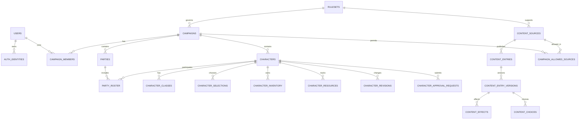

# D&D Atlas 2.0 — Database Architecture (Foundation v1)

Κατάσταση: **staging foundation** — όχι ολοκληρωμένο API ή character builder.

## Αρχές

1. **Ruleset:** μόνο D&D 5e 2024 (`dnd5e-2024`). Δεν ενεργοποιούμε 2014 rules ή legacy content χωρίς μελλοντική ρητή απόφαση.
2. **Cloudflare:** GitHub Pages PWA → Cloudflare Worker (authorization/rules validation) → D1. WebSockets/Durable Objects αργότερα, για broadcast μετά από επιτυχημένο Save.
3. **Content vs Character:** `content_*` tables ορίζουν reusable classes/species/spells/items/feats και rule effects. `character_*` tables αποθηκεύουν επιλογές, στιγμιαίους πόρους και revisions, όχι αντίγραφα όλων των definitions.
4. **Content licensing:** `content_sources` περιλαμβάνει `license_code`, `scope`, `redistributable`. `PROPRIETARY` δεν σημαίνει δικαίωμα φιλοξενίας ή διανομής. Μόνο υλικό με επιβεβαιωμένη άδεια και επιτρεπόμενα δεδομένα δημοσιοποιείται. Δεν εισάγεται πλήρες επίσημο PHB/DMG από αυτό το migration.
5. **EL/EN:** translations ανά version. Ο server επιλέγει μόνο επιτρεπόμενο content, ο client επιλέγει `en` ή `el` UI. Τα ελληνικά όρων αναφέρουν EN όπου απαιτείται.
6. **Campaign isolation:** κάθε membership είναι `(campaign_id, user_id)`. Τα `characters` απαιτούν εγγεγραμμένο owner στο ίδιο campaign· το `party_roster` έχει σύνθετα foreign keys και δεν επιτρέπει cross-campaign characters.
7. **Permissions:** Ο *server* ελέγχει campaign membership, role (`dm`/`co_dm`/`player`), ownership, status, source entitlements και DM overrides **σε κάθε request**. Η D1 δεν διαθέτει built-in row-level security. `platform_admins` δεν γράφεται από public API.
8. **Private content:** `character_private_content` απομονώνει background story/notes. Μόνο owner και DM (ή ελεγχόμενος administrative access) βλέπουν ιδιωτικό story. Αν `story_public` true, μόνο το συγκεκριμένο story μπορεί να δημοσιοποιείται. Τα `character_revisions`/`realtime_outbox`/`notifications` δεν πρέπει να αντιγράφουν μη κρυπτογραφημένα προσωπικά story/notes.
9. **Edits:** χαρακτήρας με `revision` για optimistic concurrency (`UPDATE ... WHERE revision=?`). Ο Worker απορρίπτει stale saves (`409`). Τα `character_revisions` και `audit_log` καταγράφουν sanitized αλλαγές. DM-controlled αλλαγές περνούν από `character_approval_requests`.
10. **Events:** σε μία D1 transaction γράφονται domain change + outbox record. Μόνο μετά το commit γίνεται fan-out (WebSocket). Η D1 είναι source of truth. Το event payload περιέχει identifiers/revision και ποτέ κρυφά attributes. Μετά από reconnect ο client ζητά εξουσιοδοτημένο snapshot.
11. **No dice UI:** ο Builder συλλέγει αποτελέσματα τυχόν χειροκίνητων rolls, δεν υλοποιεί dice roller.
12. **No destructive changes:** το migration είναι additive και εφαρμόζεται μόνο στη νέα `dndatlas-v2-staging-db`. Το παλιό `main`, Worker και D1 δεν επηρεάζονται.

## Οντότητες ανά domain

| Domain | Tables |
|---|---|
| Identity | `users`, `auth_identities`, `auth_sessions`, `platform_admins` |
| Campaign | `campaigns`, `campaign_members`, `campaign_invitations`, `campaign_allowed_sources` |
| Party and play | `parties`, `party_roster`, `game_sessions` |
| Official/custom content | `rulesets`, `content_sources`, `content_entries`, `content_entry_versions`, `content_translations`, `content_prerequisites`, `content_choices`, `content_effects`, `content_relationships` |
| Characters | `characters`, `character_classes`, `character_selections`, `character_resources`, `character_inventory`, `character_private_content`, `character_revisions`, `character_approval_requests` |
| Delivery and logs | `notifications`, `realtime_outbox`, `audit_log` |

## Κύριες σχέσεις

## Όρια Foundation v1

Το schema **δεν υλοποιεί** ακόμη Google Sign-In, invitation accept flow, full automatic rules validation, homebrew editor, image tagging, combat encounters, live Durable Objects broadcast, DM overrides API ή Character Builder UI. Αυτά θα ακολουθήσουν σε ξεχωριστά migrations/API modules μετά από tests.

Επιπλέον, η D1 επιβάλλει structural constraints αλλά όχι όλη τη νομιμότητα κανόνων: ο Rules Engine ελέγχει selection availability, subclasses, multiclass totals, feature source/version, spell limits, equipped effects, attunement και source restrictions. Διαφορετικές εκδόσεις content entries παραμένουν immutable ώστε τα παλιά characters να αναπαράγονται προβλέψιμα.

## Αρχική διαδικασία migration

- `database/migrations/0001_atlas_v2_foundation.sql`: non-destructive schema + μοναδικό seed `rulesets`.
- `tests/test_atlas_v2_schema.py`: τοπικοί SQLite contract tests.
- Cloudflare Wrangler D1 migrations με `--remote` **μόνο στο staging** και με ξεχωριστή διαδρομή εκτέλεσης από το frontend deployment.
- Μελλοντικά migrations είναι νέα αρχεία (`0002_...sql`) — ποτέ edit εφαρμοσμένου migration.
